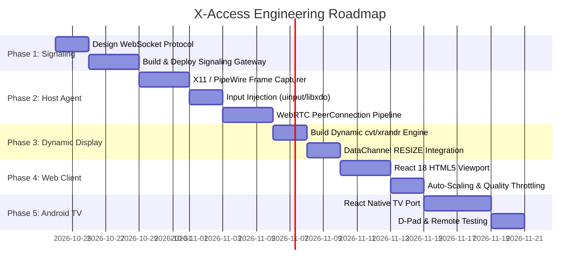

# X-Access: Phase-by-Phase Implementation Plan

This document outlines the concrete implementation roadmap for building, deploying, and validating **X-Access**.

---

## 📅 Roadmap Overview



---

## 🚀 Phase 1: Lightweight Signaling Server

### Objective
Create a minimal WebSocket signaling gateway to coordinate SDP handshakes and ICE candidate exchange between peers.

### Tasks
1. Initialize Go module: `go mod init github.com/ArionGD/x-access-signaling`.
2. Implement WebSocket hub managing active rooms and peer pairings:
   * Event `join(room_id, secret_token)`.
   * Event `signal(room_id, { sdp | candidate })`.
3. Add session authentication (simple shared secret or JWT).
4. Containerize via Docker:
   ```dockerfile
   FROM golang:1.22-alpine AS builder
   WORKDIR /app
   COPY . .
   RUN go build -o server .
   FROM alpine:latest
   COPY --from=builder /app/server /server
   EXPOSE 8080
   CMD ["/server"]
   ```
5. Deploy to the free Oracle x86 micro-VM and verify memory usage is **< 25 MB RAM**.

---

## 🖥️ Phase 2: Host Agent (Screen Capture & Input Injection)

### Objective
Build the background daemon running on the remote workstation that captures the desktop screen and accepts remote input.

### Tasks
1. **Screen Capture Engine**:
   * Implement frame grabber using `pion/webrtc` (Go) or GStreamer pipeline:
     ```bash
     gst-launch-1.0 ximagesrc use-damage=0 ! video/x-raw,framerate=30/1 ! videoconvert ! vp8enc cpu-used=4 deadline=1 ! rtpvp8pay ! ...
     ```
2. **WebRTC Streamer**:
   * Establish connection with Signaling Server.
   * Attach video track to WebRTC peer connection.
3. **Input Injection**:
   * Handle mouse moves, clicks, and keystrokes from DataChannel.
   * Integrate `libxdo` (`XDoTool`) or Linux kernel `uinput`.
4. Verify sub-20ms local capture and encoding latency.

---

## 📐 Phase 3: Dynamic Resolution & Auto-Scale Engine

### Objective
Enable instantaneous desktop resizing to non-standard aspect ratios (`720×640`, `1080×1280`, `1440×900`) without server restarts.

### Tasks
1. Write the dynamic resolution shell helper `/usr/local/bin/x-access-resize`:
   ```bash
   #!/bin/bash
   W=$1
   H=$2
   NAME="${W}x${H}_xaccess"
   MODELINE=$(cvt $W $H 60 | sed -n '2p' | sed -e 's/Modeline //')
   PARAMS=$(echo $MODELINE | awk '{for(i=2;i<=NF;++i)print $i}')
   DISPLAY=:0 xrandr --newmode "$NAME" $PARAMS 2>/dev/null || true
   DISPLAY=:0 xrandr --addmode DUMMY0 "$NAME" 2>/dev/null || true
   DISPLAY=:0 xrandr --output DUMMY0 --mode "$NAME"
   ```
2. In the Host Agent, listen on DataChannel for:
   ```json
   { "action": "RESIZE", "width": 1080, "height": 1280 }
   ```
3. Trigger the resize script and verify that the virtual display adapts instantly without crashing X11.

---

## 🌐 Phase 4: Modern Web Client (React + Next.js)

### Objective
A zero-install web application that opens in any browser, authenticates, and displays the desktop.

### Tasks
1. Build React viewport component:
   * `<video>` element with `object-fit: contain`.
   * `ResizeObserver` listener that sends debounced resize events to host.
2. Input Handlers:
   * Capture mouse coordinates relative to video frame.
   * Handle keyboard events, including function keys, Ctrl/Cmd shortcuts, and Alt.
3. Add quick preset buttons on top bar:
   * `Auto-Fit Window` (Default)
   * `Square (720×640)`
   * `Portrait Mobile (1080×1280)`
   * `Widescreen (1280×720)`
   * `Full HD (1920×1080)`
4. Add telemetry overlay: Ping / Latency, FPS, Bitrate, and Packet Loss.

---

## 📺 Phase 5: React Native Companion (Mobile & Android TV)

### Objective
Extend X-Access to smart TVs and mobile devices.

### Tasks
1. Integrate `react-native-webrtc` into React Native TV template.
2. Implement D-Pad remote navigation:
   * Remote Select button triggers virtual mouse click.
   * Remote Arrow keys move virtual mouse pointer or shift focus between windows.
3. Test wireless deployment onto physical Android TV over Wi-Fi (`adb connect <TV_IP>:5555`).

---

## 🧪 Testing & Verification Checklist

- [ ] Signaling server runs under 30 MB RAM on Oracle x86 micro-VM.
- [ ] WebRTC P2P direct connection establishes in < 1 second within Mumbai region.
- [ ] Round-trip latency is verified **< 25 ms**.
- [ ] Resizing browser window from wide to narrow triggers instant resolution update on host.
- [ ] Typing and mouse clicks feel native with zero perceptible lag.
