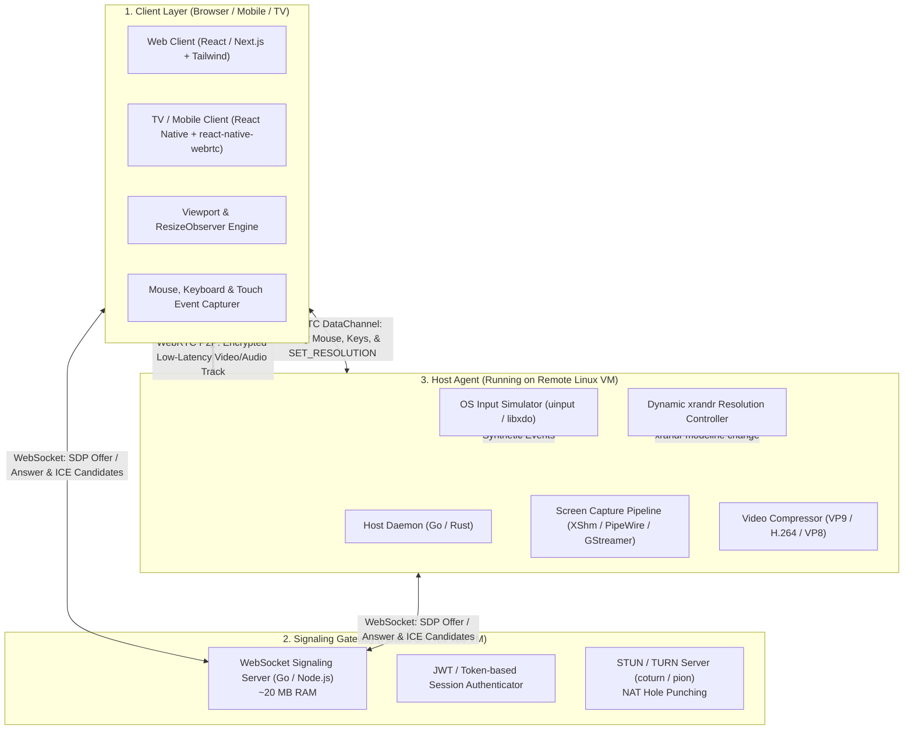

# X-Access: Technology Stack & System Architecture

## 1. System Architecture Diagram

---

## 2. Technology Choices & Rationale

### A. Signaling Server
* **Language / Framework**: **Go (`gorilla/websocket` or `nhooyr/websocket`)** or **Node.js (`ws`)**.
* **Role**: Orchestrates WebRTC peer connection handshakes (SDP negotiation and ICE candidates).
* **RAM Footprint**: **< 25 MB RAM**.
* **Deployment Target**: Oracle Cloud Always Free AMD x86 micro-VM (`VM.Standard.E2.1.Micro`).
* **Why**: The signaling server only carries text handshakes for a few seconds during connection initiation; after the handshake, all heavy video and audio packets flow peer-to-peer directly between client and host.

### B. Host Agent (Target Machine)
* **Language**: **Go** (with `pion/webrtc`) or **Rust**.
* **Screen Capture Engine**:
  * **X11**: `XShmGetImage` (shared memory X11 capture) or GStreamer `ximagesrc`.
  * **Wayland**: PipeWire / Portal desktop capture.
* **Video Encoding**:
  * Software: `libvpx` (VP8/VP9) or `x264` (H.264).
  * Hardware (if available): VA-API / NVENC.
* **Input Injection**:
  * Linux `uinput` kernel module (for low-level virtual keyboard/mouse creation).
  * `libxdo` (xdotool library) for direct X11 window events.
* **Dynamic Display Controller**:
  * Interacts with `xrandr` on X11 virtual dummy displays (`DUMMY0` or virtual framebuffers) to calculate dynamic CVT modelines on the fly.

### C. Web Client (Browser)
* **Framework**: **React 18 / Next.js 14** + **Tailwind CSS**.
* **Video Renderer**: Standard HTML5 `<video>` element with hardware WebRTC decoding.
* **Input Capture**:
  * Pointer Lock API (for smooth gaming / desktop mouse capture without edge boundaries).
  * Standard keyboard event capture (`keydown`, `keyup` with modifier tracking).
* **Auto-Scaling Engine**:
  * Uses `ResizeObserver` on the video container element.
  * Sends debounce-throttled `{ event: "RESIZE", width, height }` packets over the WebRTC DataChannel.

### D. Mobile & Android TV Client
* **Framework**: **React Native** + **`react-native-tvos`**.
* **WebRTC Integration**: `react-native-webrtc`.
* **TV Navigation**: D-Pad focus management, cursor virtualization, and remote key handling (`useTVEventHandler`).

---

## 3. WebRTC DataChannel Communication Protocol

Control commands and input events travel through an unordered, low-latency binary WebRTC DataChannel (`dc_control`):

| Message Type | Direction | Payload Example | Purpose |
| :--- | :--- | :--- | :--- |
| `MOUSE_MOVE` | Client → Host | `[1, x, y]` (uint16 coordinates) | Moves the remote cursor |
| `MOUSE_DOWN` | Client → Host | `[2, button_id]` (1=Left, 2=Right, 3=Mid) | Mouse button press |
| `MOUSE_UP` | Client → Host | `[3, button_id]` | Mouse button release |
| `MOUSE_SCROLL`| Client → Host | `[4, delta_x, delta_y]` | Mouse wheel scrolling |
| `KEY_DOWN` | Client → Host | `[5, key_code, modifiers]` | Key press |
| `KEY_UP` | Client → Host | `[6, key_code]` | Key release |
| `SET_RESOLUTION`| Client → Host | `{"type": "RESIZE", "w": 1080, "h": 1280}` | Triggers dynamic host resize |
| `HOST_STATUS` | Host → Client | `{"fps": 30, "rtt": 18, "cpu": 12}` | Live telemetry & metrics |
